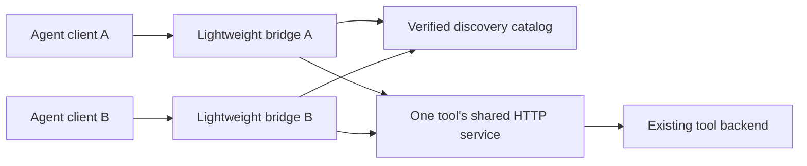

# MCP Lifecycle: Lightweight Clients, Shared Backends

A Python transport and technical case study from an OpenBot integration. It addresses three related challenges: discovering tools without immediately starting a backend, keeping client sessions separate, and handling a lost response without replaying a write.

[Run the checks](#run-the-checks) · [Explore the implementation](http_stdio.py) · [Read the case study](docs/case-study.md).

**By Tim Smykov.** I designed and implemented the runtime integration using AI-assisted development. OpenBot and the MCP ecosystem are upstream systems; this repository focuses on the client-side transport work, not authorship of those platforms.

## The problem

An agent opening a connection should not need to start a new expensive backend merely to discover available tools. Sharing a backend also must not merge mutable client sessions. If a connection disappears after a write, retrying automatically can execute that write twice.

## The implementation

`http_stdio.py` forwards JSON-RPC from stdio to one MCP HTTP service over a Unix-domain socket. Each bridge has its own session. A source-fingerprinted discovery catalog can answer initialization and tool listing before a backend connection is made. A later business request initializes the real session.

The original integration combined this client with per-tool, on-demand services. This public extraction includes the portable stdio client and its tests; the deployment manager, private registries and production session state are not included.



## Run the checks

Python 3.10 or newer. No API keys, model calls, OpenBot installation or third-party Python packages are required.

```sh
python3 -m unittest -v
```

Tests cover cached discovery without a connection, source fingerprint changes, session initialization, no automatic write replay, and actual local HTTP-over-Unix-socket calls with distinct client sessions and a lost acknowledgment.

## Use the transport

With your own already-running compatible local MCP HTTP service:

```sh
python3 http_stdio.py --socket /path/to/your-tool.sock
```

Input and output are newline-delimited JSON-RPC on stdio. The socket is local; deployment permissions and backend authorization remain your responsibility. `X-OpenBot-*` headers carry integration attribution, not a security boundary. The optional catalog format and behavioral limits are documented in [the case study](docs/case-study.md).

## What this demonstrates

- Discovery can be handled without opening a backend connection.
- Distinct bridges retain distinct session identifiers while using the same server.
- A transport failure returns an explicit error instead of replaying a write.
- Reconnection is session setup, not proof that the previous business operation failed.

The tests measure behavior, not real-world memory/cost savings or full MCP compatibility. The local fixture models a bounded protocol subset and does not validate every streaming, cancellation or server-request behavior. See [verification](docs/verification.md) and [provenance](NOTICE.md).
